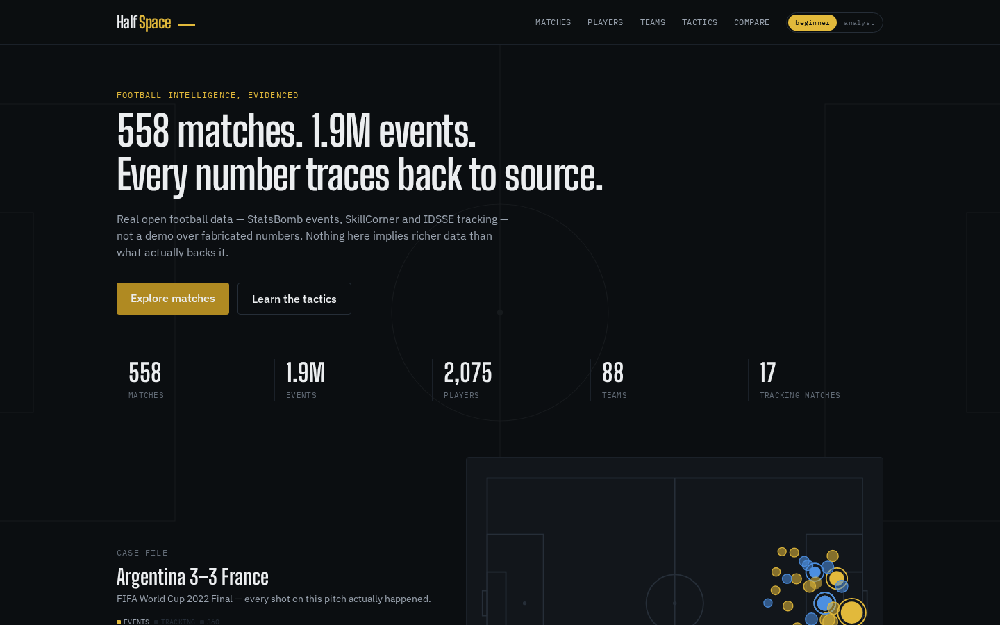
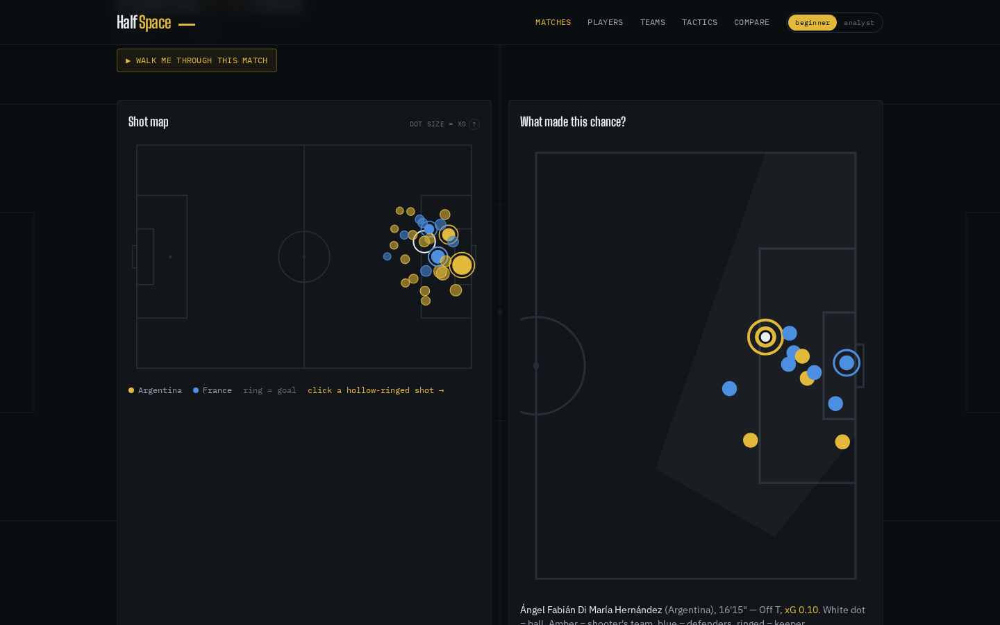
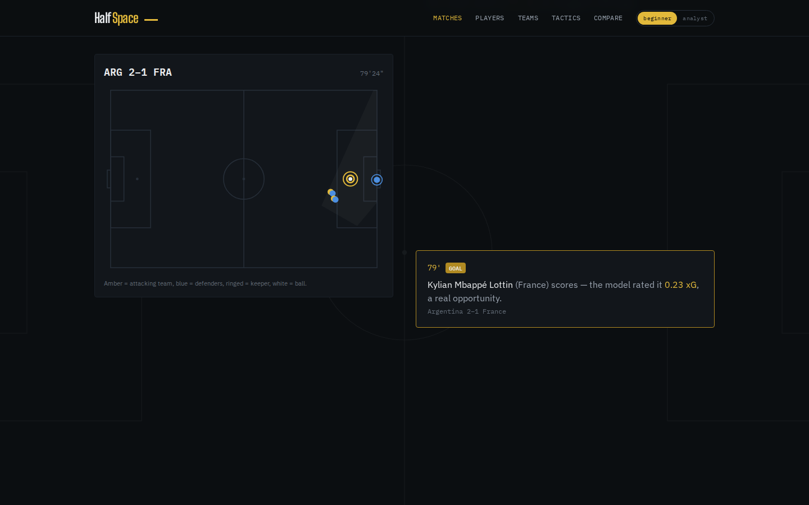
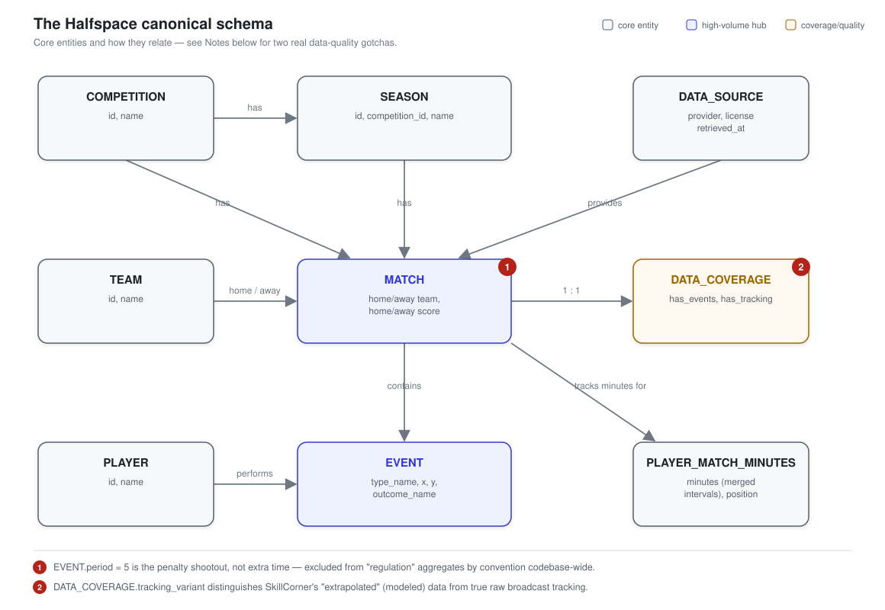

# HalfSpace

**Football analysis you can trace back to the source.** HalfSpace turns real open football data into match stories, player and team profiles, tactical explainers and an AI analyst, and every number links back to the data that produced it.




## What you can do with it

- **See what made a chance.** Click any shot in a match and see where all 22 players were standing the instant it was taken, from real StatsBomb 360 freeze-frames. No paid tracking feed needed.
- **Get walked through a match.** A scroll-driven story of every goal and big chance, in plain language: who scored, how good the chance was (xG), and what the score became.
- **Explore players and teams.** Per-90 profiles, role-aware "players like this one", head-to-head comparisons, and pressing intensity (PPDA). The comparison flags itself when it isn't apples to apples, for example a striker against a goalkeeper.
- **Learn the tactics.** 19 tactical concepts, each tagged with how much the data can actually support it, from "educational" to "unsupported".
- **Ask the analyst.** An AI agent answers questions by calling the same query layer the API uses, and shows exactly which calls backed its answer.
- **Switch depth.** A Beginner/Analyst toggle changes every metric explainer from plain English to method notes. Jargon is always one tap from a real explanation.






## The data

Everything is real, open and reproducible. Nothing is mocked or generated.

| Source | Coverage | Kind |
|---|---|---|
| StatsBomb Open Data | World Cup 2022 (64), La Liga 2015/16 (380), Euro 2024 (51), Copa América 2024 (32), Women's Euro 2025 (31) | Event data, **558 matches / about 1.9M events** |
| StatsBomb 360 | World Cup 2022, Euro 2024, Women's Euro 2025 (146 matches) | About 459k freeze-frames of player positions |
| SkillCorner Open Data | A-League 2024/25 (10 matches) | Broadcast tracking, modeled and extrapolated |
| IDSSE | Bundesliga 2022/23, 1. and 2. division (7 matches) | Optical tracking at 25 fps |

Each match carries a coverage record (events, 360, tracking), and the UI shows it as a three-tick strip on every card. The app never implies richer data than a match actually has.

## How it works


Every layer is disk-backed and can be inspected on its own. Nothing calls a data provider while a request is being served.



### The agent

`halfspace/agent/` is a small, auditable tool-calling loop:

- **Tools** (`tools.py`): 13 tools, each a thin wrapper over the same `lookups` and `features` functions the API calls. There is no SQL in the agent, so it can't see anything the UI can't.
- **Orchestrator** (`orchestrator.py`): runs the loop and enforces two rules in code, not in the prompt. Every tool call is recorded as provenance, and if a tool returns a `caveat` or `error`, it is tracked until the answer restates it. A 6-round budget makes a stuck agent fail loudly.
- **LLM client** (`llm.py`): an OpenAI-compatible client, currently pointed at [Groq](https://console.groq.com) (free tier, `openai/gpt-oss-120b`). The orchestrator only depends on a small `LLMClient` protocol, so the model is swappable.

Example, run against the real dataset (output abridged):

```text
$ python scripts/ask_agent.py "Compare Messi and Neymar in La Liga 2015/16. Who creates more chances and who presses more?"

Neymar: 2.36 key passes/90, 11.28 pressures/90
Messi:  1.90 key passes/90,  6.14 pressures/90
Both are well over the 900-minute floor, so the sample is reliable.

tools: list_competitions, get_season_players(sort_by="key_passes_p90")
unresolved caveats: []
```

## Quick start

Requires Python 3.10+ (developed on 3.14) and a recent Node (the frontend uses Vite 8).

```bash
git clone <this repo> && cd Halfspace
python3 -m venv .venv && .venv/bin/pip install -r requirements.txt
```

### 1. Run the tests (no data needed)

```bash
.venv/bin/python3 -m pytest tests -q
```

On a fresh clone this gives `6 passed, 33 skipped`. The 33 skipped tests check real data, so they skip until you ingest some (below). The 6 that run use small committed fixtures.

### 2. Load some data

Raw files are cached in `data/raw/` and never committed. The SQLite database is built in `data/halfspace.db`.

**Quick set (a few minutes, mostly download time):** World Cup 2022 with 360 freeze-frames. This is enough for the match page, shot explorer, walkthrough and most of the UI.

```bash
.venv/bin/python3 scripts/ingest_competition.py 43 106 --360
.venv/bin/python3 scripts/train_shot_model.py
```

Run the tests again: about 28 pass and the rest skip. The skipped ones need La Liga and tracking data.

**Full set (about 1.5 GB database, about 6 GB raw cache, tracking is the slow part):**

```bash
.venv/bin/python3 scripts/ingest_competition.py 11 27            # La Liga 2015/16
.venv/bin/python3 scripts/ingest_competition.py 55 282 --360     # Euro 2024
.venv/bin/python3 scripts/ingest_competition.py 53 315 --360     # Women's Euro 2025
.venv/bin/python3 scripts/ingest_competition.py 223 282          # Copa América 2024
.venv/bin/python3 scripts/ingest_skillcorner.py                  # 10 tracking matches
.venv/bin/python3 scripts/ingest_idsse.py                        # 7 tracking matches, about 2.5 GB download
```

Now the whole suite runs: `39 passed`.

### 3. Run the app

Backend, in one terminal:

```bash
.venv/bin/uvicorn halfspace.api:app --reload
```

It pre-warms caches on startup (a few seconds). Check it with `curl localhost:8000/health`, and browse the interactive API docs at <http://localhost:8000/docs>.

Frontend, in a second terminal:

```bash
cd frontend
cp .env.example .env        # points the UI at http://localhost:8000
npm install
npm run dev
```

Open <http://localhost:5173>. Good places to start: **Matches → World Cup 2022 → the final**, then click a ringed shot, then **Walk me through this match**.

### 4. Try the agent

Get a free key from [console.groq.com](https://console.groq.com) → API Keys, then:

```bash
cp .env.example .env        # then paste your key after GROQ_API_KEY=
.venv/bin/python3 scripts/ask_agent.py "Who topped goals per 90 in La Liga 2015/16?"
```

`.env` is gitignored. The agent needs the data loaded (step 2), since it reads the same database as the API. Free tiers have per-minute and per-day limits, so heavy use may return a 429 error.

## Layout

```text
halfspace/
  db.py                   canonical schema (SQLite)
  api.py                  FastAPI surface, 23 endpoints
  lookups.py              shared read queries, used by both api.py and agent/tools.py
  tactical.py             loads tactical_concepts.json (19 concepts, each with a confidence tier)
  ingest/                 StatsBomb (events + 360), SkillCorner, IDSSE
  features/               PPDA, per-90 profiles, similarity, xG-lite, sequences, pitch data, tracking shape
  agent/                  tools.py, orchestrator.py, llm.py
scripts/                  ingest_*.py, train_shot_model.py, ask_agent.py
tests/                    pipeline, data quality, analytics, API, agent, LLM client, pitch, spatial
frontend/                 React + Vite + TypeScript + Tailwind, reads the API, no mocked data
docs/                     architecture and schema diagrams, screenshots
```

## What the tests check

The suite runs against the real dataset, not just fixtures, and has caught real bugs:

| Domain | Check | Result |
|---|---|---|
| Match | Shot map and goal timeline, 2022 World Cup final | Correct 3-3 (extra time), shootout excluded |
| Tactics | PPDA across all 64 World Cup matches | Spain and Germany press hardest, Morocco and Qatar sit deep, as known |
| Players | 380-match per-90 profiling and similarity | Suárez tops goals/90 (the real Pichichi), Messi's closest match is Neymar |
| Shot quality | xG-lite on 11,937 shots | AUC 0.79, Brier 0.083, in line with published models |
| Tracking | Team compactness across two providers | SkillCorner and IDSSE land in the same physical range |
| Agent | Real tools, scripted model | A dropped caveat is caught even when the model ignores it |

Bugs found by those tests and fixed at the shared layer: a 185-minute Messi bug (overlapping lineup segments, now merged as intervals), home/away guessed from event order (now from the match list), a dangling tactical-concept link, and a 4-second season-profile scan (now cached and pre-warmed, about 15 ms).

## Good to know

- StatsBomb logs the penalty shootout as `Shot` events in period 5, so match-level numbers use periods 1-4 only.
- "Progressive pass" would reward goalkeeper long punts, so goalkeepers are excluded.
- SkillCorner files are Git LFS, so the fetcher uses the media URL, not the raw one.
- IDSSE position files are 350-420 MB of XML each, so they are stream-parsed and downsampled to about 1 frame per second.
- Season-profile caches live for the process lifetime. Restart the API after re-ingesting.
- A shot's `x` coordinate is already in the shooting team's attacking direction, so no flipping is needed.

## Limitations

- **The agent is not in the UI yet.** It runs from the command line (`scripts/ask_agent.py`). Wiring it into the web app needs an API endpoint and a chat panel.
- **Free LLM limits.** The agent uses Groq's free tier, which caps requests per minute and per day. There is no retry or fallback model yet, so a rate limit surfaces as an error. A second provider as a fallback is planned.
- **Weaker models, weaker answers.** Tool results are capped at 25 rows so they fit free-tier limits, and the agent can only answer from what the tools return. The caveat check matches caveat text exactly, so a model that paraphrases a caveat is flagged as having dropped it.
- **Small tracking sample.** Only 17 matches have tracking data, and the SkillCorner ones are modeled from broadcast video, not measured. Tracking-based tactics are limited to team shape.
- **Simple models.** xG-lite is a logistic regression on distance, angle and header, with no defender positions. Counterattack detection is a heuristic, labeled medium confidence, not a trained classifier. Player similarity is role-aware but position-bucket based.
- **Uneven coverage.** 360 freeze-frames exist for three tournaments only. La Liga and Copa América have events but no 360. Mostly men's data, apart from the Women's Euro.
- **Heavy local data.** A full setup is about 1.5 GB of database and 6 GB of raw cache, and nothing here is hosted. Reviewers must ingest data locally to see the app.
- **SQLite, no auth, no deployment.** It is single-user and local. Postgres with pgvector is the planned move if similarity search or multiple writers need it.
- **No CI.** The suite needs the real dataset for full coverage, so it is run locally.

## Credits

Event data and 360 freeze-frames: [StatsBomb Open Data](https://github.com/statsbomb/open-data), used under StatsBomb's public data licence, which requires attribution. Tracking data: [SkillCorner Open Data](https://github.com/SkillCorner/opendata) and the IDSSE/DFL dataset. Check each provider's licence before reusing their data.
