# The Halfspace

*by **Abhijith Varma***

**Football analysis you can trace back to the source.** The Halfspace turns real open football data into match stories, player and team profiles, tactical explainers and an AI analyst, and every number links back to the data that produced it.

<p align="center">
  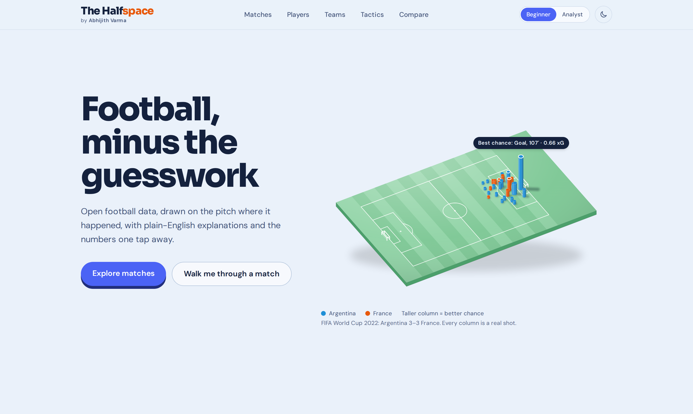
  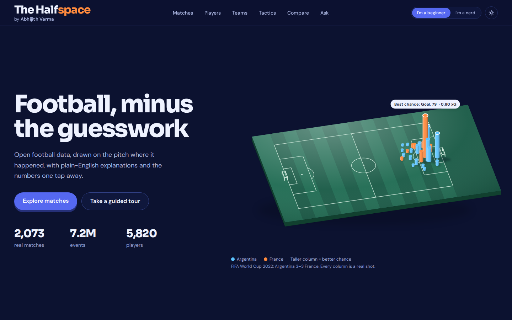
</p>


## What you can do with it

- **See what made a chance.** Click any shot in a match and see where every visible player was standing the instant it was taken, from real StatsBomb 360 freeze-frames. A "Why this chance" panel shows which factors raised or lowered its rating. A 3D view stands every shot up as a column, taller for a better chance. It zooms, turns, and opens full screen.
- **Read how a match flowed.** A written match report, a "who's on top" chart minute by minute, an xG race for both teams, both teams' pass networks on one pitch, and lists of counterattacks, corners and free kicks.
- **Scout players and teams.** A scouting card per player (percentiles within the same league season and position, role, passing against difficulty, impact on the ball), players who play alike across leagues, league leaders for 12 metrics, goalkeeper ratings, a map of how every team plays, and set-piece rankings.
- **Learn the tactics.** 19 concepts split into playing styles and tactics, filterable by phase of play and by how much the data can really support each one.
- **Ask the analyst.** Ask a football question and get a formatted answer built from the same query layer the API uses.
- **Find things fast.** Every list is searchable, sortable and filterable, and matches can be searched across all seasons.
- **Switch depth.** "I'm a beginner" or "I'm a nerd" changes how much detail pages show, from plain-language explainers to the full stats. A **How this works** page explains every calculated number and what it leaves out.

<p align="center">
  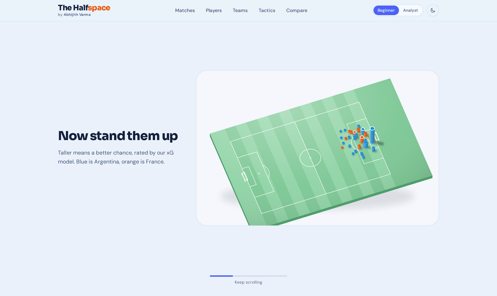
  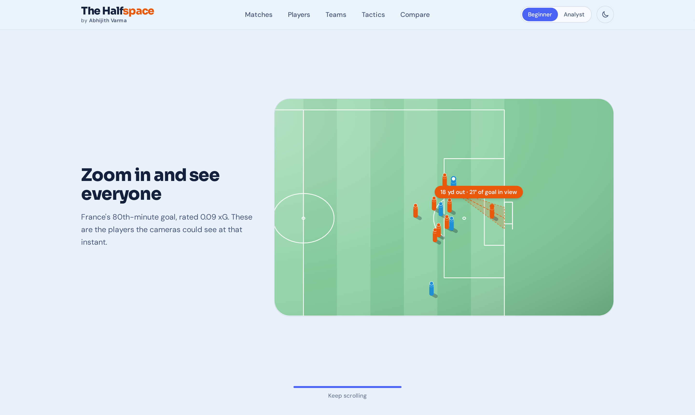
</p>

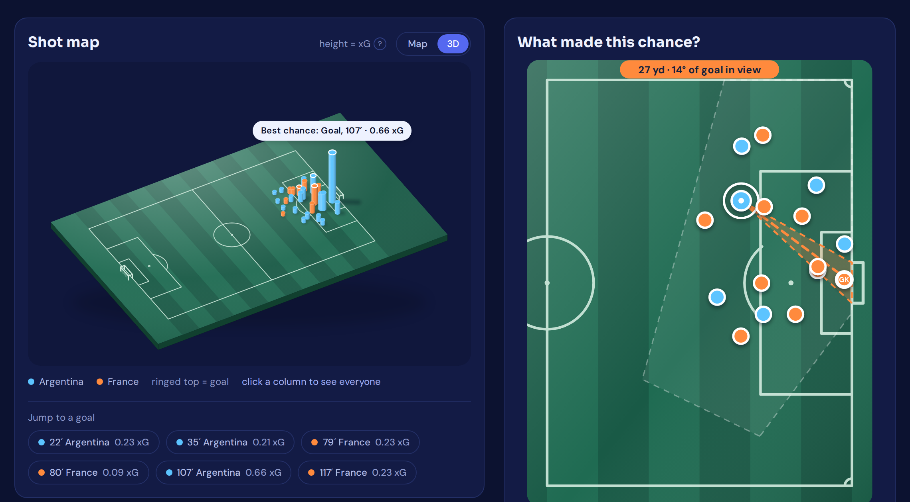

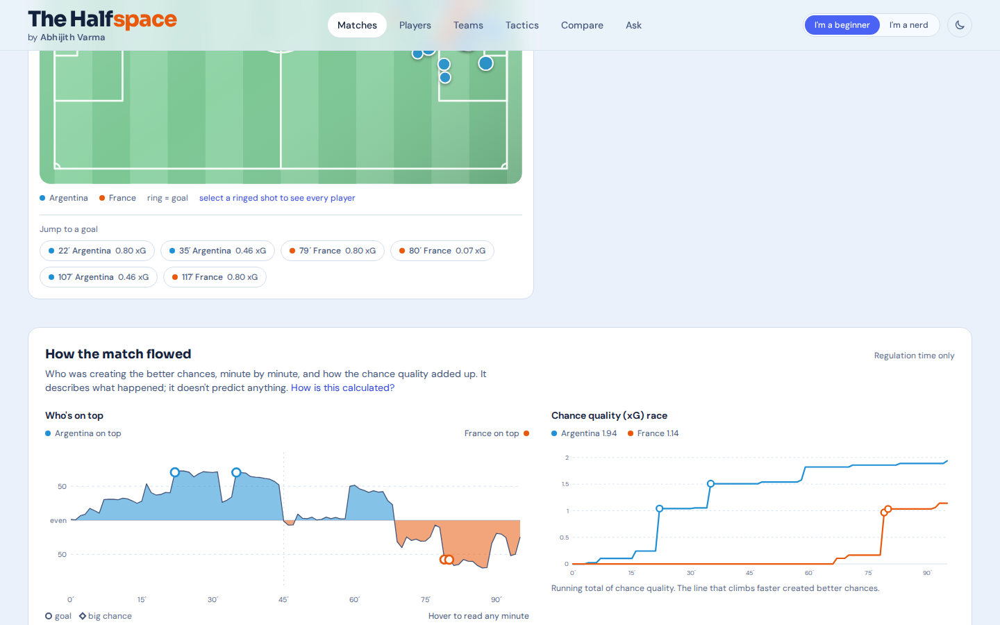

<p align="center">
  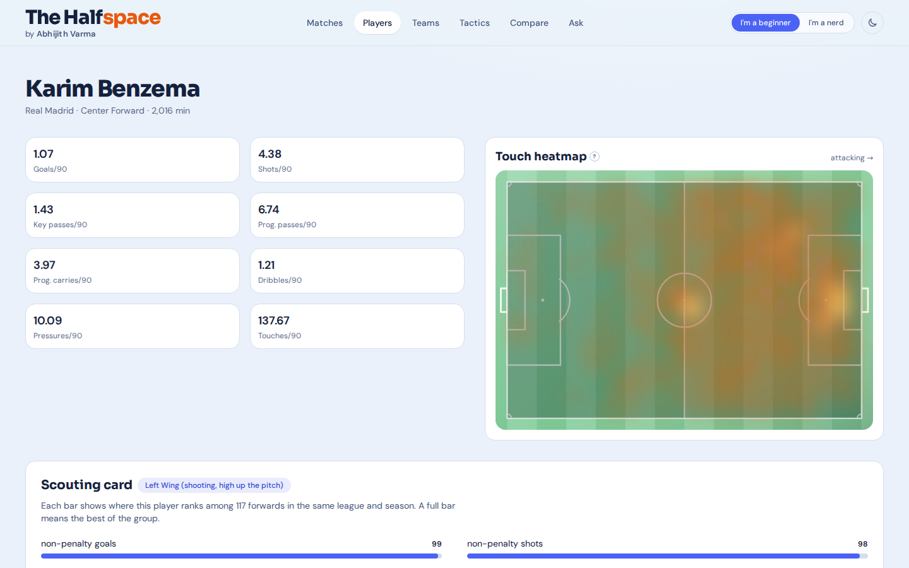
  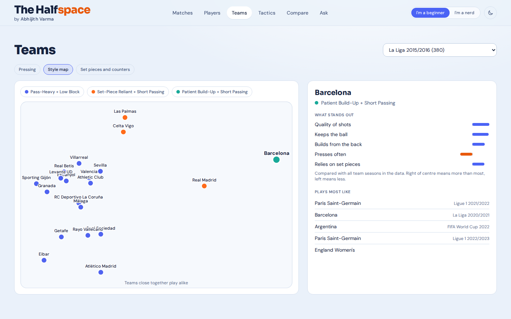
</p>

<p align="center">
  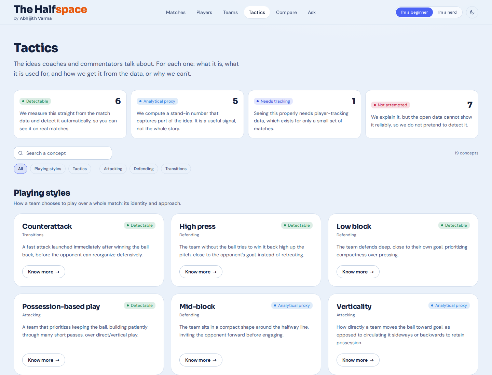
  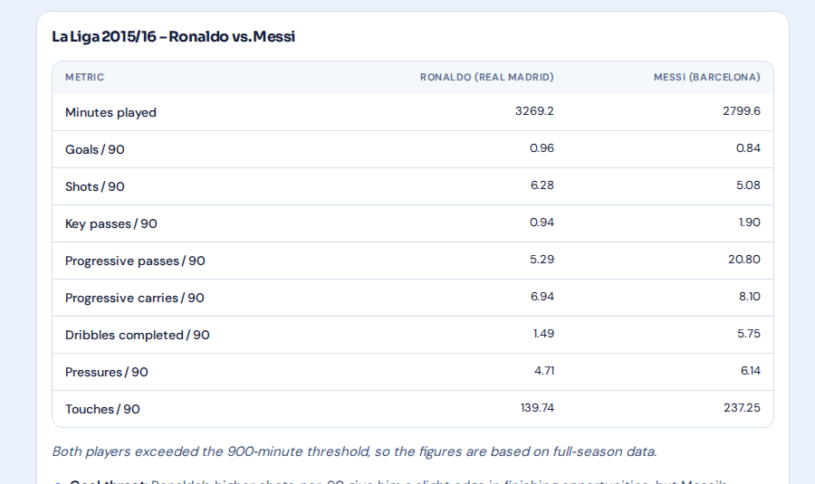
</p>

<p align="center">
  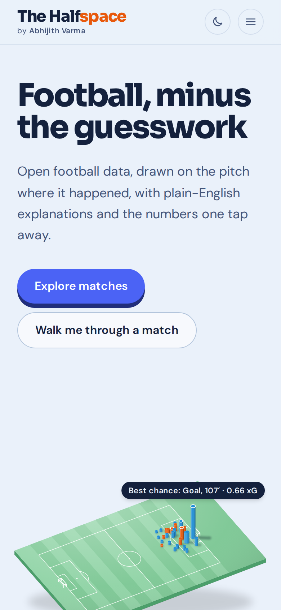
  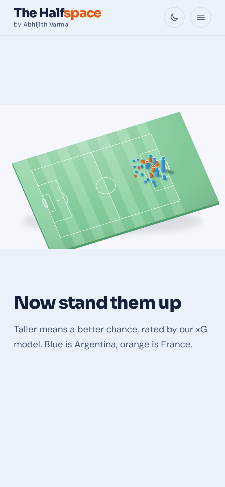
</p>

## The interface

- **One pitch, one number.** The isometric pitch is hand-written SVG, not WebGL. A single `progress` value (0 to 1) drives a camera (top-down, isometric, zoomed on the penalty area), and each frame is written straight to the DOM, so scrolling never re-renders React.
- **Smooth scroll.** [Lenis](https://github.com/darkroomengineering/lenis) runs from Motion's own frame loop, so scroll-linked animation stays in step with it. With a reduced-motion setting you get native scrolling and the intro animation is skipped.
- **Light and dark.** One set of design tokens with two sets of values, a toggle in the nav, and no flash on load. Blue and orange mark the two teams in every chart, which stays readable for colour-blind users.
- **Phones.** Every page fits a 390px screen, and the "I'm a beginner" / "I'm a nerd" switch moves into the mobile menu.

## The data

Everything is real, open and reproducible. Nothing is mocked or generated.

| Source | Coverage | Kind |
|---|---|---|
| StatsBomb Open Data | 24 competition-seasons: World Cups, Euros, Copa América, AFCON, La Liga, Ligue 1, Bundesliga, MLS, plus women's leagues (WSL, NWSL, Liga F, Frauen-Bundesliga, Serie A Women) | Event data, **2,073 matches / about 7.2M events** |
| StatsBomb 360 | 12 of those seasons, including World Cup 2022, Euro 2020 and 2024, Women's Euro 2022 and 2025 (425 matches) | About 1.36M freeze-frames of player positions |
| SkillCorner Open Data | A-League 2024/25 (20 matches) | Broadcast tracking, modeled and extrapolated |
| IDSSE | Bundesliga 2022/23, 1. and 2. division (7 matches) | Optical tracking at 25 fps |

Each match carries a coverage record (events, 360, tracking), and the UI shows it as three check marks on every match. The app never implies richer data than a match actually has.

## How it works

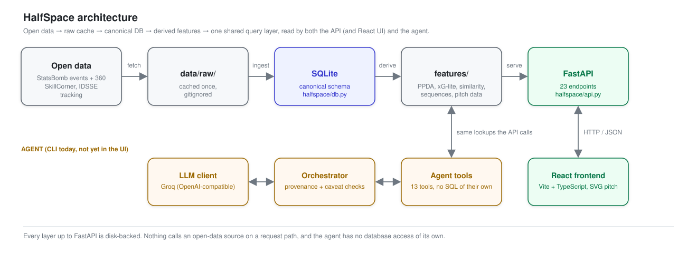

Every layer is disk-backed and can be inspected on its own. Nothing calls a data provider while a request is being served.


### The agent

`halfspace/agent/` is a small, auditable tool-calling loop:

- **Tools** (`tools.py`): 13 tools, each a thin wrapper over the same `lookups` and `features` functions the API calls. There is no SQL in the agent, so it can't see anything the UI can't.
- **Orchestrator** (`orchestrator.py`): runs the loop and enforces two rules in code, not in the prompt. Every tool call is recorded as provenance, and if a tool returns a `caveat` or `error`, it is tracked until the answer restates it. A 6-round budget makes a stuck agent fail loudly.
- **LLM client** (`llm.py`): an OpenAI-compatible client, currently pointed at [Groq](https://console.groq.com) (free tier, `openai/gpt-oss-120b`). The orchestrator only depends on a small `LLMClient` protocol, so the model is swappable.

Example, run against the real dataset (output abridged):

```text
$ python scripts/ask_agent.py "Compare Messi and Neymar in La Liga 2015/16. Who creates more chances and who presses more?"

Neymar: 2.36 key passes/90, 11.28 pressures/90
Messi:  1.90 key passes/90,  6.14 pressures/90
Both are well over the 900-minute floor, so the sample is reliable.

tools: list_competitions, get_season_players(sort_by="key_passes_p90")
unresolved caveats: []
```

## Quick start

```bash
git clone <this repo> && cd Halfspace
python3 -m venv .venv && .venv/bin/pip install -r requirements.txt

# load World Cup 2022 with 360 freeze-frames (a few minutes), then train the xG model
.venv/bin/python3 scripts/ingest_competition.py 43 106 --360
.venv/bin/python3 scripts/train_shot_model.py

.venv/bin/uvicorn halfspace.api:app --reload --port 8742      # API on :8742, docs at /docs
cd frontend && cp .env.example .env && npm install && npm run dev   # UI on :5817
```

Open <http://localhost:5817> and try **Matches → World Cup 2022 → the final**, click a ringed shot, then **Guided match story**.

The full setup guide (all competitions, tracking data, the agent, the test suite) is in **[docs/DEVELOPMENT.md](docs/DEVELOPMENT.md)**.

## Tech stack

Python, FastAPI, SQLite, scikit-learn (xG-lite), React, Vite, TypeScript, Tailwind, Framer Motion and Lenis. Agent over an OpenAI-compatible API (Groq). Type: Sora and DM Sans.

## Validation

The test suite (80 tests) runs against the real dataset and has caught real bugs. Examples: the 2022 final comes out 3-3 with the shootout excluded, Suárez tops La Liga 2015/16 goals per 90, Messi's closest player match is Neymar, and xG v2 scores AUC 0.82 on 53,000 shots. Details in [docs/DEVELOPMENT.md](docs/DEVELOPMENT.md#what-the-tests-check).

## Status and limitations

- The analyst is a stateless chat: the browser sends the conversation back each time, and nothing is stored on the server.
- Free-tier LLM limits, softened by a 3-model fallback chain.
- Only 27 matches have tracking data (20 SkillCorner, 7 IDSSE). 360 freeze-frames cover 12 of the 24 competition-seasons (none for the women's leagues).
- Local only: SQLite, no auth, no deployment, no CI.
- The interface has been checked in Chromium at desktop and 390px widths. Safari, Firefox and tablet widths haven't been tested.
- The 3D pitch is drawn per frame in SVG, which is smooth for one match's shots (about 30 to 40 columns). A match with far more shots, or a season-wide view, would need a canvas or WebGL renderer.

Full list in [docs/DEVELOPMENT.md](docs/DEVELOPMENT.md#limitations).

## Credits

Event data and 360 freeze-frames: [StatsBomb Open Data](https://github.com/statsbomb/open-data), used under StatsBomb's public data licence, which requires attribution. Tracking data: [SkillCorner Open Data](https://github.com/SkillCorner/opendata) and the IDSSE/DFL dataset. Check each provider's licence before reusing their data.

Designed and built by Abhijith Varma. Fonts: [Sora](https://fonts.google.com/specimen/Sora) and [DM Sans](https://fonts.google.com/specimen/DM+Sans), both under the SIL Open Font Licence.
