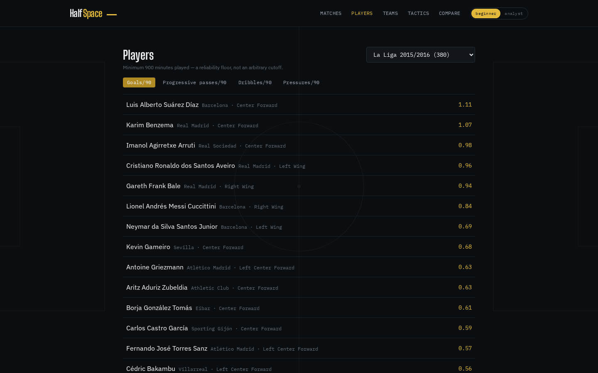

# HalfSpace

**Football analysis you can trace back to the source.** HalfSpace turns real open football data into match stories, player and team profiles, tactical explainers and an AI analyst, and every number links back to the data that produced it.


## What you can do with it

- **See what made a chance.** Click any shot in a match and see where all 22 players were standing the instant it was taken, from real StatsBomb 360 freeze-frames. No paid tracking feed needed.
- **Get walked through a match.** A scroll-driven story of every goal and big chance, in plain language: who scored, how good the chance was (xG), and what the score became.
- **Explore players and teams.** Per-90 profiles, role-aware "players like this one", head-to-head comparisons, and pressing intensity (PPDA). The comparison flags itself when it isn't apples to apples, for example a striker against a goalkeeper.
- **Learn the tactics.** 19 tactical concepts, each tagged with how much the data can actually support it, from "educational" to "unsupported".
- **Ask the analyst.** An AI agent answers questions by calling the same query layer the API uses, and shows exactly which calls backed its answer.
- **Switch depth.** A Beginner/Analyst toggle changes every metric explainer from plain English to method notes. Jargon is always one tap from a real explanation.




## The data

Everything is real, open and reproducible. Nothing is mocked or generated.

| Source | Coverage | Kind |
|---|---|---|
| StatsBomb Open Data | World Cup 2022 (64), La Liga 2015/16 (380), Euro 2024 (51), Copa América 2024 (32), Women's Euro 2025 (31) | Event data, **558 matches / about 1.9M events** |
| StatsBomb 360 | World Cup 2022, Euro 2024, Women's Euro 2025 (146 matches) | About 459k freeze-frames of player positions |
| SkillCorner Open Data | A-League 2024/25 (10 matches) | Broadcast tracking, modeled and extrapolated |
| IDSSE | Bundesliga 2022/23, 1. and 2. division (7 matches) | Optical tracking at 25 fps |

Each match carries a coverage record (events, 360, tracking), and the UI shows it as a three-tick strip on every card. The app never implies richer data than a match actually has.

## How it works


Every layer is disk-backed and can be inspected on its own. Nothing calls a data provider while a request is being served.


### The agent

`halfspace/agent/` is a small, auditable tool-calling loop:

- **Tools** (`tools.py`): 13 tools, each a thin wrapper over the same `lookups` and `features` functions the API calls. There is no SQL in the agent, so it can't see anything the UI can't.
- **Orchestrator** (`orchestrator.py`): runs the loop and enforces two rules in code, not in the prompt. Every tool call is recorded as provenance, and if a tool returns a `caveat` or `error`, it is tracked until the answer restates it. A 6-round budget makes a stuck agent fail loudly.
- **LLM client** (`llm.py`): an OpenAI-compatible client, currently pointed at [Groq](https://console.groq.com) (free tier, `openai/gpt-oss-120b`). The orchestrator only depends on a small `LLMClient` protocol, so the model is swappable.

Example, run against the real dataset (output abridged):

```text
$ python scripts/ask_agent.py "Compare Messi and Neymar in La Liga 2015/16. Who creates more chances and who presses more?"

Neymar: 2.36 key passes/90, 11.28 pressures/90
Messi:  1.90 key passes/90,  6.14 pressures/90
Both are well over the 900-minute floor, so the sample is reliable.

tools: list_competitions, get_season_players(sort_by="key_passes_p90")
unresolved caveats: []
```

## Quick start

```bash
git clone <this repo> && cd Halfspace
python3 -m venv .venv && .venv/bin/pip install -r requirements.txt

# load World Cup 2022 with 360 freeze-frames (a few minutes), then train the xG model
.venv/bin/python3 scripts/ingest_competition.py 43 106 --360
.venv/bin/python3 scripts/train_shot_model.py

.venv/bin/uvicorn halfspace.api:app --reload      # API on :8000, docs at /docs
cd frontend && cp .env.example .env && npm install && npm run dev   # UI on :5173
```

Open <http://localhost:5173> and try **Matches → World Cup 2022 → the final**, click a ringed shot, then **Walk me through this match**.

The full setup guide (all competitions, tracking data, the agent, the test suite) is in **[docs/DEVELOPMENT.md](docs/DEVELOPMENT.md)**.

## Tech stack

Python, FastAPI, SQLite, scikit-learn (xG-lite), React, Vite, TypeScript, Tailwind. Agent over an OpenAI-compatible API (Groq).

## Validation

The test suite (43 tests) runs against the real dataset and has caught real bugs. Examples: the 2022 final comes out 3-3 with the shootout excluded, Suárez tops La Liga 2015/16 goals per 90, Messi's closest player match is Neymar, and xG-lite scores AUC 0.79 on 11,937 shots. Details in [docs/DEVELOPMENT.md](docs/DEVELOPMENT.md#what-the-tests-check).

## Status and limitations

- The agent has an API (`POST /agent/ask`, with conversation history) but no chat panel in the UI yet.
- Free-tier LLM limits, no retry or fallback model yet.
- Only 17 matches have tracking data. 360 freeze-frames cover three tournaments.
- Local only: SQLite, no auth, no deployment, no CI.

Full list in [docs/DEVELOPMENT.md](docs/DEVELOPMENT.md#limitations).

## Credits

Event data and 360 freeze-frames: [StatsBomb Open Data](https://github.com/statsbomb/open-data), used under StatsBomb's public data licence, which requires attribution. Tracking data: [SkillCorner Open Data](https://github.com/SkillCorner/opendata) and the IDSSE/DFL dataset. Check each provider's licence before reusing their data.
